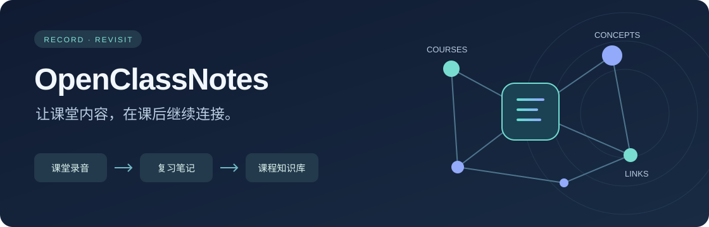

<div align="center">



**把一节课的录音，变成能复习、能提问、能串联的笔记。**

本地语音转写 · 中英课程 · Markdown 笔记 · OpenKB 知识图谱

[快速开始](#快速开始) · [日常使用](#日常使用) · [模型配置](#模型配置) · [常见问题](#常见问题)

</div>

## 能做什么

| 从一份录音开始 | 得到什么 |
| --- | --- |
| 本地转写 | 带时间戳的文字稿；支持中文、英文和自动检测 |
| 整理课堂内容 | 概念、课堂例子、老师强调的重点，以及带时间戳的考试信号 |
| 修正识别错误 | 生成笔记时一并处理明确的术语、同音字和标点错误 |
| 串联多节课 | 用 OpenKB 生成课程、概念和实体页面，关联不同课程中的共同知识 |
| 提问与浏览 | 向课程知识库提问，或切换 3D、思维导图、径向树查看关系 |
| 继续上次任务 | 已完成录音自动跳过；失败后从最近成功阶段继续 |

笔记围绕老师讲过的内容整理。公式保留名称、口述用途和考试重点；表达式与板书仍需结合课堂资料复习。目前输入为音频。

## 快速开始

需要 **Python 3.10–3.12**（推荐 3.11）和一个 LLM API Key。转写使用本地 faster-whisper；NVIDIA GPU 可选，默认自动选择 GPU 或 CPU。首次转写会下载 Whisper small 模型。

### Windows · PowerShell

```powershell
git clone https://github.com/kidouim/OpenClassNotes.git
cd OpenClassNotes
Set-ExecutionPolicy -Scope Process Bypass
.\setup.ps1
.\run.ps1
```

安装脚本在项目内创建 `.venv`。直接在 PowerShell 使用，无需 WSL、Conda 或 Docker。

### Linux / macOS

```bash
git clone https://github.com/kidouim/OpenClassNotes.git
cd OpenClassNotes
bash setup.sh
bash run.sh
```

首次运行填写 API Key，Base URL 和模型可直接按回车使用默认值。

## 日常使用

1. 把录音放进 `mp3/`，支持 `mp3`、`wav`、`m4a`、`flac`、`ogg`、`aac`。
2. 启动后选 **1 · 转换新课**，输入编号处理一节课，或直接回车处理全部待完成录音。
3. 在 `notes/` 查看笔记；选 **2** 提问，选 **3** 打开知识图谱。

```text
  OpenClassNotes

  1  转换新课          2  向知识库提问
  3  打开知识图谱      4  同步已有笔记
  5  配置 API          6  使用指南
  7  选择转录设备      8  选择录音语言

  r  重新处理课程      q  退出
```

菜单 **7 / 8** 保存设备与语言偏好。已知是中文或英文课程时，明确选择语言可以减少误判。转写过程中会显示识别进度。

也可以在启动时临时指定，优先于菜单保存的设置：

```powershell
.\run.ps1 -Device cpu -Language zh
.\run.ps1 -Device cuda -Language en
```

```bash
CLASSNOTES_DEVICE=cpu CLASSNOTES_LANGUAGE=zh bash run.sh
```

已有 Markdown 笔记用菜单 **4** 同步，内容未变化会跳过编译。要让某节课应用新版转写和清洗规则，选 **r** 重新处理，再输入课程编号；直接回车取消。

## 模型配置

默认配置对应 [DeepSeek 官方接口](https://api-docs.deepseek.com/quick_start/pricing/)：

| 设置 | 默认值 |
| --- | --- |
| API Key | 在 [DeepSeek 平台](https://platform.deepseek.com/api_keys) 创建 |
| Base URL | `https://api.deepseek.com` |
| 模型 | `deepseek-flash` |

菜单 **5** 可更换地址、Key 和模型，也支持其他 OpenAI Chat Completions 兼容服务。笔记生成使用 DeepSeek 的非思考模式；笔记输出不完整时最多尝试三次。

**哪些步骤会调用 API？** 转写稿整理为笔记、笔记编译为 OpenKB Wiki、知识库问答。语音转写和图谱生成在本地完成。长课程会分段整理；格式重试也会产生额外请求。

录音在本地转写，整理时会将转写文本发送给所配置的服务；OpenKB 编译和问答会发送相应笔记、问题及知识库内容。API Key 保存在用户目录的 `~/.class-notes/config.json`，通过隐藏输入填写。

## 文件放在哪里

```text
OpenClassNotes/
├── mp3/                  录音
├── transcripts/          带时间戳的转写稿
├── notes/                Markdown 复习笔记
├── graphs/               断点续跑状态
└── knowledge/
    ├── wiki/             课程、概念和实体页面
    └── output/visualize/
        └── graph.html    可用浏览器直接打开的交互图谱
```

这些课程数据目录已由 Git 忽略。发生转写纠错时，原稿备份放在 `~/.class-notes/raw_transcripts/`。

## 最近更新

- **设备与语言选择**：菜单保存偏好，启动参数可临时覆盖。
- **Windows GPU 转写**：自动寻找 CUDA/cuDNN 运行库；转写放在独立子进程，减少原生库退出异常对主程序的影响。
- **进度显示**：加载语音模型时给出提示，识别时显示百分比。
- **笔记输出恢复**：增加输出额度和格式重试；纠错清单格式异常时保留可用笔记与原转写。

## 常见问题

<details>
<summary>GPU 没有用上，或转写失败</summary>

Windows GPU 转写需要可用的 NVIDIA 驱动、CUDA 12 和 cuDNN 9 运行库。程序会查找 CUDA Toolkit 和本地 PyTorch 运行库，也可用 `CLASSNOTES_CUDNN_PATH` 指定 cuDNN 目录。自动模式在 GPU 失败时回退 CPU；显式选择 CUDA 时会报告错误。

先用 `.\run.ps1 -Device cpu` 确认 CPU 转写正常。

</details>

<details>
<summary>知识图谱为空，或浏览器没有自动打开</summary>

先转换一节课，或用菜单 4 同步已有笔记，再打开图谱。程序会打印 `graph.html` 的本地路径，也可以手动打开。

</details>

<details>
<summary>模型下载出现 Hugging Face 警告</summary>

未登录可能影响下载限额；Windows 缓存缺少符号链接权限时会多占一些磁盘空间。模型能正常下载时可以继续使用。

</details>

## 开发

```powershell
.\.venv\Scripts\python.exe -m unittest discover -s tests -v
```

Linux / macOS 使用 `.venv/bin/python -m unittest discover -s tests -v`。自动测试使用临时数据和模拟响应，无需真实 API Key。

知识库编译、问答和可视化基于 [VectifyAI/OpenKB](https://github.com/VectifyAI/OpenKB)，作为 Python 依赖安装。OpenClassNotes 与 OpenKB 均采用 Apache 2.0 许可证，详见 [LICENSE](LICENSE)。
